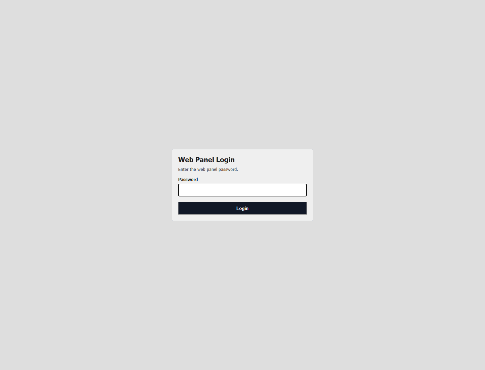
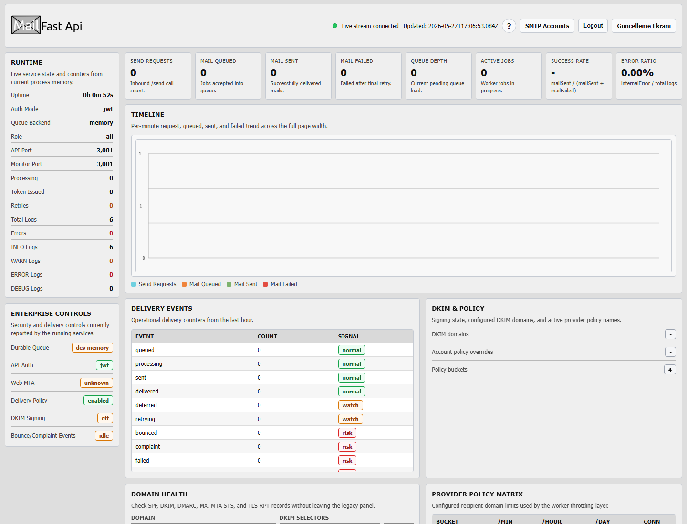
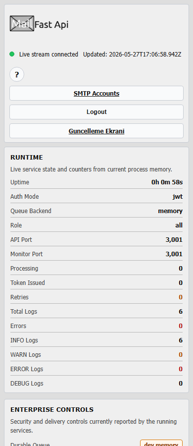
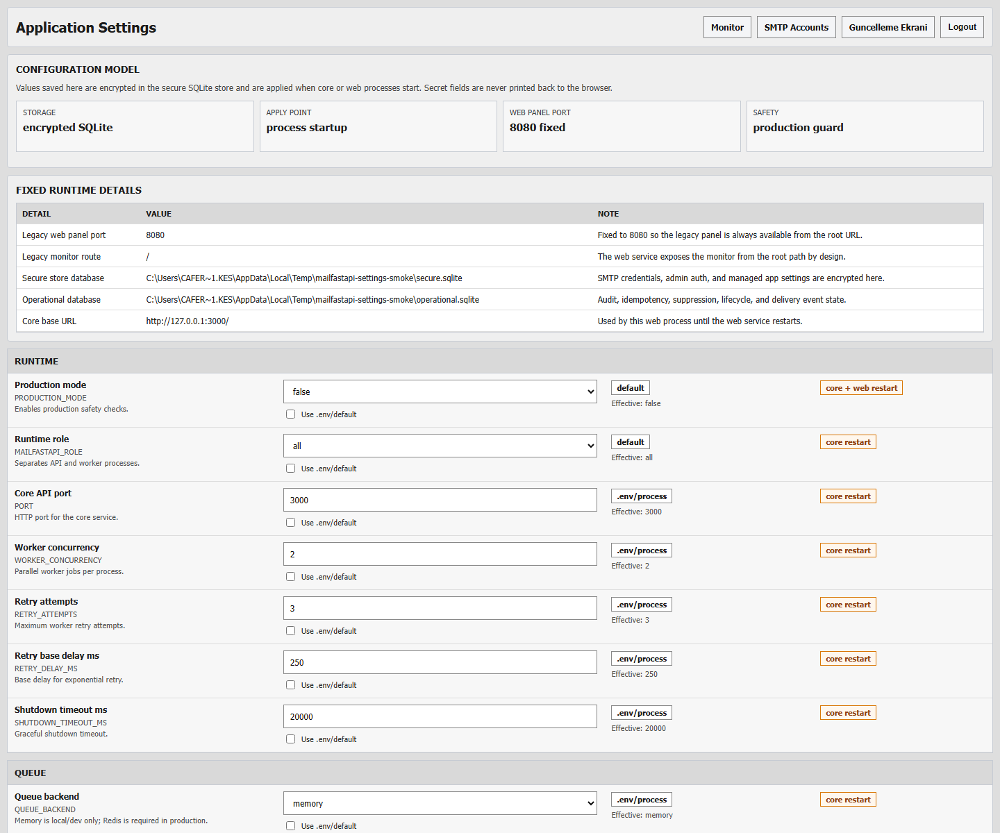

# mailFastApi

<p align="center"></p>

[](package.json)
[](docs/OPERATIONS.md#environment)
[](LICENSE)

**Queue email quickly. Follow each delivery attempt.**

mailFastApi is a self-hosted **Node.js/Express** email API that separates request
handling from SMTP delivery. Accept a message, queue it, and let background
workers send it through pooled SMTP accounts while you follow retries, failures,
and delivery activity in a web panel or structured logs.

Built for noncommercial projects, personal labs, and email-system experiments.
The source is available under a [custom noncommercial license](LICENSE).

[Quick start](#quick-start) · [API reference](docs/API_DOCS.md) ·
[Operations](docs/OPERATIONS.md) · [License](docs/LICENSING.md)

## What you can do

| Capability | What it provides |
| --- | --- |
| Asynchronous delivery | `POST /send` returns `202 queued` after queue acceptance, without waiting for SMTP delivery. |
| Redis queue | Processing leases, acknowledgements, expired-job recovery, and deferred delivery. A memory backend is available for development. |
| Separate runtime roles | Run API and worker processes independently with `MAILFASTAPI_ROLE=api`, `worker`, or `all`. |
| Multiple SMTP accounts | Select accounts per message, reuse Nodemailer connection pools, and manage credentials in an encrypted SQLite vault. |
| Retry and recovery | Bounded worker retries, persisted dead-letter jobs, manual replay, and configurable automatic retries. |
| Delivery controls | Idempotency, configurable suppression, domain/account policies, bounce and complaint ingestion, and unsubscribe support. |
| Operations panel | Monitor queue activity, manage SMTP accounts and encrypted settings, inspect metrics, and check updates. |
| Access controls | JWT or API-key authentication, rate limiting, panel sessions, optional TOTP MFA, and production configuration checks. |
| Observability | Structured SQLite/JSONL logs, delivery events, Prometheus metrics, and DNS/domain-health diagnostics. |

A `202` response means **accepted into the queue**, not delivered to the recipient.
Redis lease recovery provides at-least-once processing; it is not an exactly-once
delivery guarantee. SMTP acceptance also does not prove inbox placement.

## How it works

```text
Client -> Core API -> Redis queue -> Worker -> SMTP provider
              |                        |
              +---- SQLite state + structured logs
              |
Web panel -> Monitor APIs, SMTP accounts, settings, update controls
```

The core API defaults to port `3000`; the separate web service uses port `8080`.
SQLite stores operational records, logs, and an encrypted credential/settings
vault. Redis handles the durable queue; its persistence and recovery policy are
part of the deployment configuration.

## Quick start

Requirements:

- Git, npm, and Node.js with the built-in `node:sqlite` module enabled.
- **Node.js 22.13+** for the commands below. The manifest declares 22.5.0 as its
  minimum, but Node.js 22.5–22.12 requires `NODE_OPTIONS=--experimental-sqlite`.
  See the [Node.js SQLite history](https://nodejs.org/api/sqlite.html).
- An SMTP account you are authorized to use, if you want to send real mail.
- Redis for the normal queue backend; the local walkthrough below uses memory.

There is currently no published GitHub Release. Start from the source repository:

```bash
git clone https://github.com/KES-KING/mailFastApi.git
cd mailFastApi
npm ci
cp .env.example .env
```

Edit `.env` before starting. For a local development run, set:

```dotenv
PRODUCTION_MODE=false
MAILFASTAPI_ROLE=all
QUEUE_BACKEND=memory
WEB_HOST=127.0.0.1
```

Replace `SECURE_STORE_KEY`, `JWT_SECRET`, and `AUTH_CLIENT_SECRET` with distinct
random values, and set `MONITOR_TOKEN` and `BOUNCE_WEBHOOK_TOKEN`. Generate a
fresh value for each secret with:

```bash
node -e "console.log(require('node:crypto').randomBytes(32).toString('hex'))"
```

Keep `.env` private. Keep the secure-store key with your vault backup; an existing
encrypted vault cannot be opened with a newly generated key. The memory queue
is for local development and loses queued jobs when its process stops.

Start the two services in separate terminals from the project directory:

```bash
# Terminal 1: API and worker
npm start core
```

```bash
# Terminal 2: web panel
npm start web
```

Open `http://localhost:8080`, create the initial administrator password, and add
an account under **SMTP Accounts**. SMTP credentials are managed in the encrypted
vault rather than in `.env`. Check the core at `http://localhost:3000/health`.
Keep this development setup on a trusted local network; the core API has no
loopback-only bind setting in this walkthrough.

For Redis, set `QUEUE_BACKEND=redis` and `REDIS_URL` to your server. For separate
API and worker processes, use `npm start api` and `npm start worker` with shared
queue configuration and access to the required state. Detailed environment,
service installation, update, and recovery instructions are in the
[operations guide](docs/OPERATIONS.md).

## API at a glance

| Endpoint | Purpose |
| --- | --- |
| `POST /auth/token` | Exchange configured client credentials for a JWT in JWT mode. |
| `POST /send` | Validate and enqueue a message using the configured authentication mode. |
| `GET /health` | Inspect core health and queue/worker state. |
| `GET /monitor/stats`, `GET /monitor/stream` | Read monitoring snapshots and live events. |
| `GET /metrics` | Read Prometheus-format metrics. |

The monitor and metrics endpoints require `x-monitor-token` when
`MONITOR_TOKEN` is set. The separate web panel authenticates with its own session
and supplies this token when proxying core monitoring requests.

Example `/send` body after configuring an SMTP account:

```json
{
  "smtpAccount": "default",
  "to": "recipient@example.com",
  "subject": "Hello from mailFastApi",
  "text": "A message from a noncommercial test project."
}
```

Requests support multiple recipients, optional sender selection, HTML, and
base64 attachments. The [API reference](docs/API_DOCS.md) describes authentication,
request limits, idempotency, suppression, webhook payloads, and error responses.

## Web panel preview

These existing screenshots were captured on **2026-05-27**. They illustrate that
snapshot of the panel; they are not evidence of a fresh browser test.

### Login



### Monitor — desktop



<details>
<summary>Mobile monitor and encrypted application settings</summary>





</details>

## Deployment boundaries

The repository includes installers for Linux/systemd, macOS/launchd, and Windows
Scheduled Tasks, plus an updater with fast-forward checks, rollback, and optional
signed-tag verification. Their operation depends on the target platform and
configuration; see [installers](docs/OPERATIONS.md#cross-platform-installer) and
[updater behavior](docs/OPERATIONS.md#updater).

`PRODUCTION_MODE=true` enables configuration checks. It is not a production
acceptance certificate or a commercial-use grant. Deployments still need suitable
TLS termination, protected admin access, secret handling, database/queue backups,
Redis persistence, sender-domain configuration, and SMTP-provider policy checks.
The [deployment guide](docs/ENTERPRISE_HARDENING.md) records the implemented
controls and remaining external responsibilities. Technical support for a feature
does not override the [noncommercial use conditions](docs/LICENSING.md).

## Development and verification

```bash
npm ci
npm test
```

The default suite uses isolated test state and SMTP fixtures, uses the memory
queue, and skips the explicitly enabled real-email scenario. It does not prove
live Redis failover, actual SMTP delivery, or inbox placement.

See [Tests/README.md](Tests/README.md) for test modes and load helpers. The
[2026-05-27 test report](docs/TEST_REPORT.md) is historical. Real-send tests,
load profiles, and dead-letter replay can send email; their explicit opt-in and
recovery commands are documented in the [operations guide](docs/OPERATIONS.md#tests).

## Documentation

| Document | Contents |
| --- | --- |
| [API reference](docs/API_DOCS.md) | Authentication, payloads, responses, monitor endpoints, and delivery controls |
| [Operations](docs/OPERATIONS.md) | Configuration, process roles, installers, updates, retries, and CLI logs |
| [Deployment guide](docs/ENTERPRISE_HARDENING.md) | Implemented controls and external deployment responsibilities |
| [Test harness](Tests/README.md) | Isolated tests, real-send opt-in, and load-test options |
| [Historical test report](docs/TEST_REPORT.md) | Recorded results and screenshots from 2026-05-27 |
| [License guide](docs/LICENSING.md) | Permitted use, earlier GPL versions, and contribution terms |
| [Third-party notices](THIRD_PARTY_NOTICES.md) | Dependency licenses and redistribution notices |

## Contributing

Report reproducible bugs and feature requests through
[GitHub Issues](https://github.com/KES-KING/mailFastApi/issues). Include the Node.js
version, operating system, queue backend, expected behavior, and reproduction
steps. Remove secrets and personal recipient/message data from shared logs.

For a contribution, fork the repository, work on a separate branch, run the
relevant tests, and open a pull request. Include tests for behavior changes and
explain effects on queueing, retries, idempotency, suppression, or delivery.
Contributions must be compatible with the [current license](docs/LICENSING.md#contributions).

## License

The project's own code and documentation use the
[mailFastApi Noncommercial License 1.0](LICENSE). **Commercial use is prohibited
under this license**, including internal business workflows, paid services/SaaS,
and commercial product integration. Noncommercial use, modification, and sharing
are subject to the full license terms.

This revision is source available; it is not offered as GPL, AGPL, or OSI-approved
open-source software. Previously granted GPL rights remain valid for earlier
copies and code available under those terms. Third-party dependencies keep their
own licenses. See the [license guide](docs/LICENSING.md) for the exact scope.
